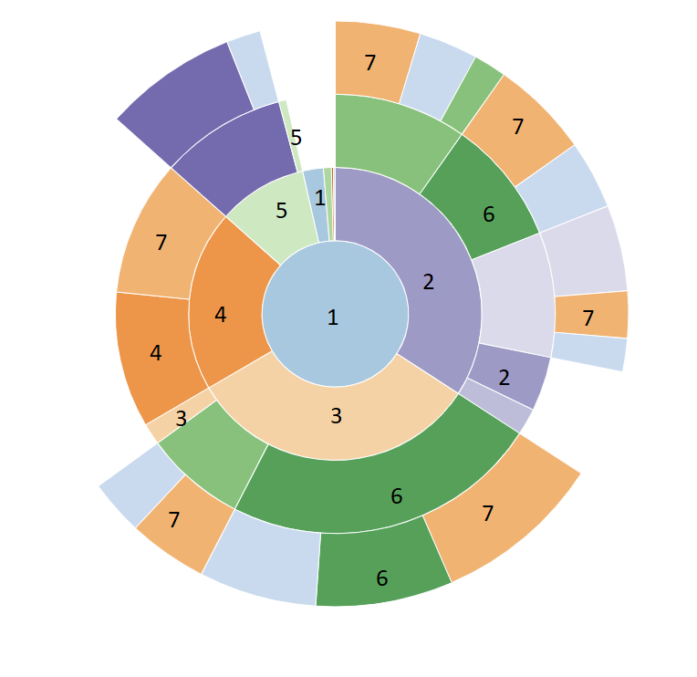

# Profiling: een Sudoku-solver versnellen

Je krijgt een Sudoku-solver die werkt, maar langzaam is: 15 seconden tot een paar minuten per puzzel. Te langzaam om bijvoorbeeld automatisch nieuwe puzzels te genereren, want dat vraagt om heel veel keer oplossen. Jouw taak: maak de solver **sneller** en laat met metingen zien dat het ook echt sneller is.

Bij elke verbetering doorloop je dezelfde cyclus: **meten, aanpassen, opnieuw meten**. Verwacht niet dat elke verbetering werkt. Dat een aanpassing in theorie sneller zou moeten zijn, betekent niet dat dat in de praktijk ook zo is.

## Aan de slag

[Download de distributiecode](sudoku_profiling.zip), pak het zip-bestand uit en open de map in je editor. Installeer daarna de benodigde packages:

```
python -m pip install -r requirements.txt
```

Gebruik je [uv](https://docs.astral.sh/uv/)? Maak dan eerst een virtual environment en installeer daarin:

```
uv pip install -r requirements.txt
```

Dan werken `pytest` en `snakeviz` als hieronder.

> Lukt een commando als `pytest` of `snakeviz` niet? Probeer dan `python3 -m pytest` of `python3 -m snakeviz`.

### Wat staat waar?

| Bestand | Wat |
| --- | --- |
| `sudoku.py` | De class `Sudoku` en `load_from_file`. **Dit is het enige bestand dat je aanpast en inlevert.** |
| `solve.py` | De solver zelf: een recursieve Depth First Search solver die lege plekken invult. Dit bestand pas je niet aan. |
| `puzzles/` | Zes puzzels (`1.csv` t/m `6.csv`). |
| `tests/` | Tests voor `Sudoku` en `solve`. Deze moeten blijven slagen. |

`solve.py` roept steeds dezelfde methodes van `Sudoku` aan: `is_solved`, `next_empty_index`, `options_at`, `place` en `unplace`. Die methodes (en wat ze weer aanroepen) bepalen dus bijna alle rekentijd.

### Hoe draai je het?

Los een puzzel op, bijvoorbeeld puzzel 2:

```
python3 solve.py 2
```

Met `-n` los je dezelfde puzzel meerdere keren op, handig voor een betrouwbaardere meting:

```
python3 solve.py -n 10 2
```

Kies een puzzel die bij je doel past. Puzzel 2 is binnen een seconde klaar en dus fijn om snel te itereren. Puzzel 1 duurt zo'n 15 seconden en is geschikt om te controleren of je echt winst boekt. Meet niet op iets dat korter duurt dan een seconde of twee: kleine schommelingen in de tijd zeggen dan niets.

Controleer na elke aanpassing dat alles nog klopt:

```
pytest
```

## Profilen met cProfile

Je zou kunnen gokken welk deel van de code traag is, maar dat gaat vaak mis. Een **profiler** draait je programma en houdt bij welke functies worden aangeroepen, hoe vaak, en hoeveel tijd ze kosten. Python heeft er een ingebouwd: `cProfile`.

Maak een profiel van je programma en sla het op in `solve.prof`:

```
python3 -m cProfile -o solve.prof solve.py 2
```

> `python3 -m` draait een module (hier `cProfile`) in plaats van een bestand. Een profiler maakt je programma wat trager. Vergelijk profielen dus met elkaar, niet met je gewone looptijd.

Je kunt zo'n profiel als tabel lezen, bijvoorbeeld met `python3 -m pstats solve.prof`, maar dat is onoverzichtelijk. Daarom gebruiken we **snakeviz**, dat het profiel in je browser visualiseert:

```
snakeviz solve.prof
```



Dit is een *sunburst*. In het midden staat `solve`. Elke ring daaromheen bestaat uit functies die door de vorige ring worden aangeroepen. Hoe groter een stuk, hoe meer tijd. Je kunt klikken om in te zoomen en met de muis over een stuk gaan voor de cijfers. Onderaan de pagina staat dezelfde informatie als tabel, die je kunt sorteren.

De belangrijkste kolommen:

- **ncalls**: hoe vaak de functie is aangeroepen.
- **tottime**: tijd in de functie zelf, *zonder* de functies die hij aanroept.
- **cumtime**: tijd in de functie *inclusief* alles wat hij aanroept.

Een functie met een hoge `tottime` is zelf traag. Een functie met een hoge `cumtime` maar lage `tottime` besteedt zijn tijd in andere functies. En een functie met een enorme `ncalls` is wellicht niet traag, maar wordt veel te vaak aangeroepen.

## Verbeteren

Het profiel vertelt je *waar* de tijd naartoe gaat, niet *waarom*. Dat uitzoeken is jouw werk. Let op:

- Loops, vooral geneste.
- Datastructuren en hun operaties, zie [de tijdcomplexiteit van Python-operaties](https://wiki.python.org/moin/TimeComplexity). Zijn er operaties die O(n) of erger zijn?
- Dubbel of onnodig werk: wordt hetzelfde steeds opnieuw berekend?
- Het aantal aanroepen: kan een functie minder vaak worden aangeroepen?
- Caching, bijvoorbeeld met [`functools.lru_cache`](https://docs.python.org/3/library/functools.html#functools.lru_cache).

En een paar adviezen:

- Als een aanpassing de code slechter maakt en nauwelijks sneller, laat hem dan weg.
- Als een aanpassing wél flink sneller is, is dat een winst. Voor deze opdracht gaat snelheid voor leesbaarheid.
- Kijk af en toe uit naar het geheel. Verdwaal niet in kleine functies. Moet je wel zoeken naar een lege plek, bijvoorbeeld?

## Inleveren

Ga naar het tabblad *Submit* voor wat je precies inlevert.
